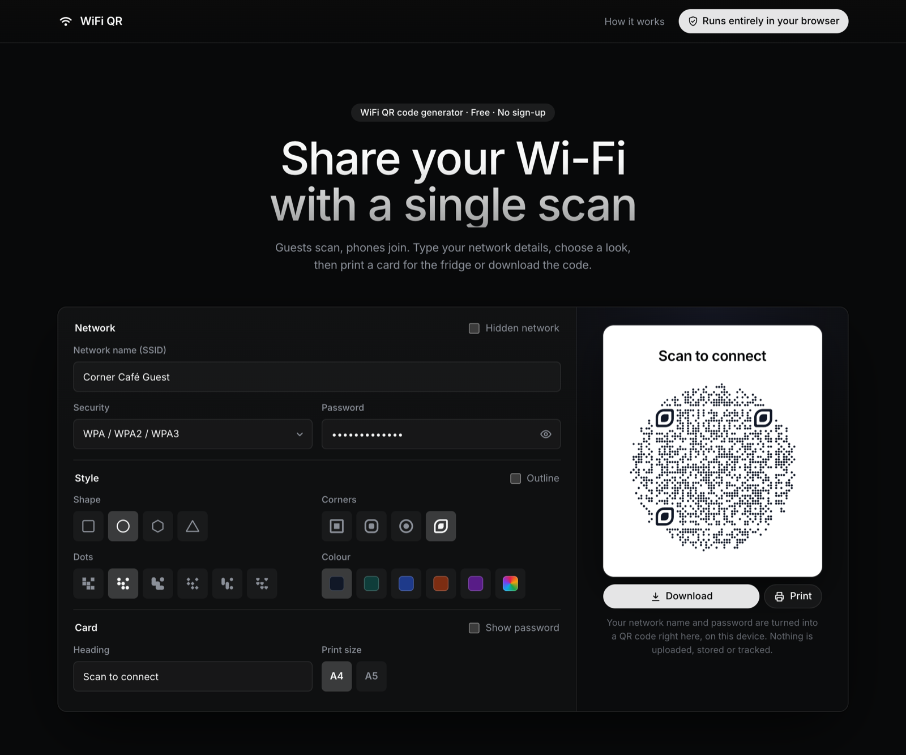

# WiFi QR Code Generator

A free, static page that turns a Wi-Fi network name and password into a QR code.
Guests point their phone camera at it and join the network – no typing.

**Live site:** https://levonux.github.io/wifi-qr/



## Features

- WPA / WPA2 / WPA3, WEP and open networks, plus hidden-network support
- Special characters (`\ ; , : "`) are escaped correctly in the `WIFI:` payload
- QR code shapes: square, circle, hexagon and triangle, with several dot styles and four corner styles (including a custom "leaf" eye)
- A clean printable card: heading and QR code, optionally the password
- Print layouts for A4 and A5; one Download menu for PNG (1200 px) or SVG
- Works on phones; dark, minimal design with a self-hosted Inter font
- **Runs entirely in the browser.** No backend, no analytics, no external
  requests – the network name and password never leave the page.

## Run locally

The page uses ES modules, so it has to be served over HTTP rather than opened
as a file. Any static server works, for example:

```sh
git clone https://github.com/LevonUX/wifi-qr.git
cd wifi-qr
python3 -m http.server 8000
```

Then open http://localhost:8000.

There is no build step and nothing to install.

## Deploy to GitHub Pages

1. Push this repository to GitHub.
2. In **Settings → Pages**, set **Source** to *Deploy from a branch*, branch `main`, folder `/ (root)`.
3. The site appears at `https://levonux.github.io/wifi-qr/` after a minute.

## Project layout

```
index.html                 page markup and copy
assets/app.js              form handling, WIFI: payload, export
assets/style.css           styles, including print styles for A4/A5
assets/favicon.svg         icon
assets/fonts/              Inter (SIL OFL 1.1)
vendor/qr-code-shapes/     the QR rendering library (unmodified, MIT)
```

## Credits and license

QR codes are drawn with [qr-code-shapes](https://github.com/koloqr/qr-code-shapes)
by KoloQR, used under the MIT License. A copy of the library and its license is in
[`vendor/qr-code-shapes/`](vendor/qr-code-shapes/).

The Inter font is © The Inter Project Authors, licensed under the
[SIL Open Font License 1.1](assets/fonts/OFL.txt).

This project is released under the [MIT License](LICENSE).
